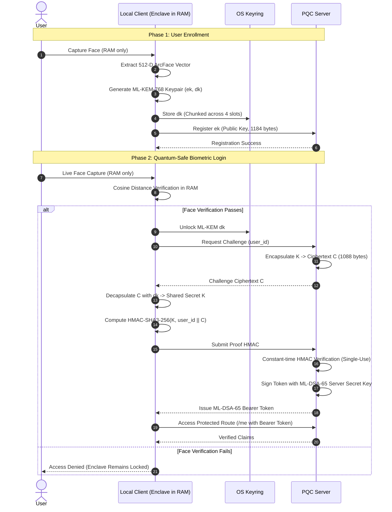

# Post-Quantum Biometric Authentication System
### *Zero-Knowledge Facial Vault powered by NIST FIPS 203 (ML-KEM) & FIPS 204 (ML-DSA)*

[](https://www.python.org/downloads/)
[](https://fastapi.tiangolo.com)
[](https://csrc.nist.gov/pubs/fips/203/final)
[](https://csrc.nist.gov/pubs/fips/204/final)
[](https://opensource.org/licenses/MIT)

---

## Overview

Traditional biometric authentication systems often transmit sensitive facial templates or rely on classical public-key cryptography (such as RSA or ECC) that is vulnerable to future quantum attacks via Shor's Algorithm.

This repository implements an end-to-end **Post-Quantum Cryptographic (PQC) Zero-Knowledge Biometric Authentication Framework**:
1. **Zero Raw Image Exposure**: Webcam frames and facial embeddings are processed purely in **RAM**. Raw photos are never stored on disk or sent over the network.
2. **Post-Quantum Key Encapsulation (ML-KEM-768 / NIST FIPS 203)**: The client generates an ML-KEM-768 keypair. Only the public key is registered with the server.
3. **OS Keyring Integration**: The private decapsulation key is split into 4 chunks and protected inside the OS Credential Manager (Windows Credential Manager / macOS Keychain / Linux Secret Service).
4. **Transcript-Bound Zero-Knowledge Challenge**: Server encapsulates a shared secret $K$ into ciphertext $C$; the client decapsulates $K$ only after a successful local biometric match and returns an `HMAC-SHA3-256(K, user_id || C)` proof.
5. **Post-Quantum Digital Signatures (ML-DSA-65 / NIST FIPS 204)**: On successful verification, the server issues a quantum-resistant signed bearer token for protected API access.

---

## Architecture Flow



---

## Project Structure

```
├── client.py            # Local biometric client (webcam capture, RAM matching, Keyring storage)
├── pqc_engine.py        # NIST FIPS 203 (ML-KEM-768) and FIPS 204 (ML-DSA-65) cryptographic core
├── server.py            # FastAPI quantum-safe challenge-response & token issuance server
├── config.py            # Centralized settings and environment loader
├── .env.example         # Template for environment variables and API keys
├── .gitignore           # Git ignore rules for caches, enclaves, and secrets
└── requirements.txt     # Python dependencies
```

---

## Security & API Key Management

All sensitive secrets, API keys, and environment variables are strictly decoupled from the source code.

- **`.env.example`**: A committed template showing all configurable options.
- **`.env`**: Your local configuration file (ignored by `.gitignore` to prevent credential leaks).
- **`config.py`**: Automatically reads environment variables and provides typed settings to the application.

If an `API_KEY` is set in `.env`, the client automatically passes it in the `X-API-Key` HTTP header, and the server validates it before processing requests.

---

## Installation

### 1. Prerequisites
- Python 3.10 or higher
- A working webcam
- C++ Build Tools (if required for compiling native cryptographic wheels)

### 2. Clone the Repository
```bash
git clone https://github.com/your-username/biometric_PQC.git
cd biometric_PQC
```

### 3. Set Up a Virtual Environment
```bash
python -m venv venv

# Windows
venv\Scripts\activate

# macOS / Linux
source venv/bin/activate
```

### 4. Install Dependencies
```bash
pip install -r requirements.txt
```

### 5. Configure Environment Variables
Copy `.env.example` to create your local `.env`:
```bash
cp .env.example .env
```
*(On Windows Command Prompt: `copy .env.example .env`)*

Edit `.env` as needed:
```ini
SERVER_HOST=127.0.0.1
SERVER_PORT=8000
SERVER_URL=http://127.0.0.1:8000

# Optional API Key for securing client-to-server calls
API_KEY=your_secure_api_key_here

# Biometric & Camera Settings
CAMERA_INDEX=0
DETECTOR_BACKEND=retinaface
ARCFACE_COSINE_THRESHOLD=0.68
ENABLE_ANTI_SPOOFING=false
```

---

## Quickstart & Usage

### 1. Start the Post-Quantum Server
Start the server using `uvicorn` or directly with Python:
```bash
python server.py
```
Or:
```bash
uvicorn server:app --host 127.0.0.1 --port 8000 --reload
```
You can access interactive API documentation at `http://127.0.0.1:8000/docs`.

### 2. Enroll a User
Run the client with the `enroll` command:
```bash
python client.py enroll alice
```
- A webcam prompt will appear.
- Look directly into the camera and press **ENTER**.
- The client extracts the ArcFace template in memory, generates an ML-KEM-768 keypair, stores the private key in the OS Keyring, and registers the public key with the server.

### 3. Authenticate / Login
Run the client with the `login` command:
```bash
python client.py login alice
```
- The client prompts for live facial capture in RAM.
- If the biometric match succeeds, the client retrieves the private key from the Keyring, solves the server's post-quantum challenge, and receives an **ML-DSA-65** signed bearer token.
- The client automatically tests the issued token against the protected `/me` endpoint.

---

## Cryptographic Specifications

| Standard | Primitive | Purpose | Key / Ciphertext Size |
|---|---|---|---|
| **NIST FIPS 203** | ML-KEM-768 (Kyber) | Zero-Knowledge Challenge Encapsulation | Public Key: 1,184 B<br>Private Key: 2,400 B<br>Ciphertext: 1,088 B |
| **NIST FIPS 204** | ML-DSA-65 (Dilithium) | Tamper-Proof Session Token Signing | Public Key: 1,952 B<br>Private Key: 4,032 B<br>Signature: 3,309 B |
| **NIST FIPS 202** | SHA3-256 / HMAC | Transcript Proof Binding | Digest: 32 B (256 bits) |
| **Biometric Model**| ArcFace (ResNet) | Facial Feature Extraction | 512-Dimensional Vector |

---

## Security Guarantees

1. **Post-Quantum Security**: Protection against Harvest-Now-Decrypt-Later (HNDL) attacks and future cryptanalytic attacks from quantum computers.
2. **Zero Biometric Server Exposure**: The authentication server never receives or stores biometric images or raw embeddings.
3. **Replay Protection**: Cryptographic challenges are bound to a 60-second time-to-live (TTL) and are immediately consumed on first attempt.
4. **Key Isolation**: Private decapsulation keys never leave the client machine and are stored chunked in OS-managed secure credentials.

---

## License

This project is licensed under the [MIT License](LICENSE).
